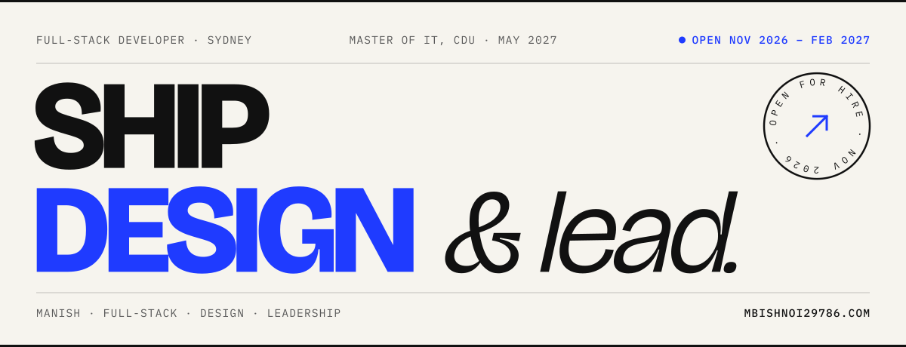
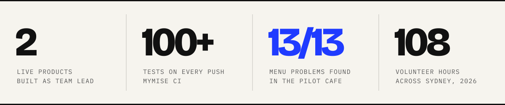
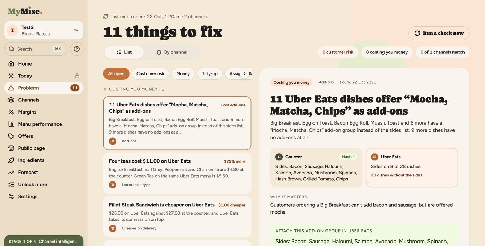
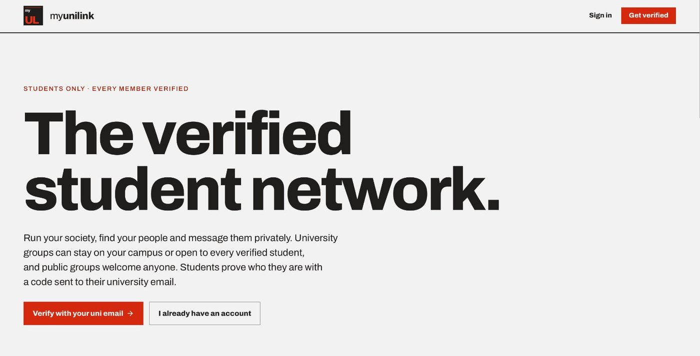
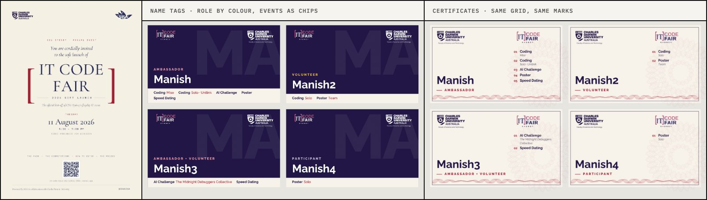

<!-- Profile README for github.com/mbishnoi29786 (this repo must stay named mbishnoi29786/mbishnoi29786).
     Availability dates live in this file and in assets/banner-*.svg — refresh both after Feb 2027.
     The Writing list is rebuilt daily from https://mbishnoi29786.com/rss.xml by .github/workflows/writing.yml. -->

<a href="https://mbishnoi29786.com">
  <picture>
    <source media="(prefers-color-scheme: dark)" srcset="assets/banner-dark.svg">
    
  </picture>
</a>

I'm Manish, a full-stack developer in Sydney finishing a Master of IT (Information Systems) at Charles Darwin University in May 2027. I have nearly two years of commercial experience building real-time apps with Node.js, React and PostgreSQL, and I've led the teams behind two live products. I care about the parts users never see: tenant isolation, access control, CI that fails loudly, endpoints that stay fast.

> **Open to work** · Summer internship, Nov 2026 – Feb 2027 · Graduate and junior developer roles from June 2027 
> **Now** · Final year of my Master of IT · Secretary of CDU Sydney SaRC · Running MyMise and MyUniLink in production

**[mbishnoi29786.com](https://mbishnoi29786.com)** &nbsp;·&nbsp; [Résumé (PDF)](https://mbishnoi29786.com/resume.pdf) &nbsp;·&nbsp; [mbishnoi29786@gmail.com](mailto:mbishnoi29786@gmail.com) &nbsp;·&nbsp; [LinkedIn](https://www.linkedin.com/in/mbishnoi29786)

  <picture>
    <source media="(prefers-color-scheme: dark)" srcset="assets/stats-dark.svg">
    
  </picture>

## Live products

<table>
  <tr>
    <td width="50%" valign="top">
      
      <h3>MyMise</h3>
      
Menu checking for cafes. Fuzzy-matches a cafe's counter, QR and Uber Eats menus, then runs nine rules for price, size, add-on and description gaps. It found all 13 problems in the pilot cafe's menus. Every business is walled off with PostgreSQL row-level security.

      
<b>LIVE SINCE AUG 2026</b> · began as a four-person CDU capstone I led Python · FastAPI · PostgreSQL 16 · Expo / React Native · Azure · GitHub Actions

      
<a href="https://mymise.com.au"><b>Live site</b></a> &nbsp;·&nbsp; <a href="https://mbishnoi29786.com/work#mymise"><b>Case study</b></a> &nbsp;·&nbsp; <a href="https://mbishnoi29786.com/blog/mise-nine-rules">How the nine rules work</a>

    </td>
    <td width="50%" valign="top">
      
      <h3>MyUniLink</h3>
      
The verified student network. Students prove who they are with a code sent to their uni email, then run societies, join groups on campus or across universities, RSVP to events and message privately over encrypted chat. Live for CDU and Torrens students.

      
<b>LIVE SINCE OCT 2025</b> · built with a team I led TypeScript · Node.js · Express 5 · React · PostgreSQL · Prisma · Socket.IO · AWS · Vercel

      
<a href="https://myunilink.com.au"><b>Live site</b></a> &nbsp;·&nbsp; <a href="https://mbishnoi29786.com/work#myunilink"><b>Case study</b></a>

    </td>
  </tr>
</table>

**Earlier** &nbsp;[custom-rule-engine](https://github.com/mbishnoi29786/custom-rule-engine): a modular rule evaluator with REST APIs and Jest tests, built in one day for a hackathon and selected. &nbsp;[LetsChat](https://github.com/mbishnoi29786/LetsChat): encrypted real-time chat with Flask and Socket.IO, for Harvard's CS50.

## Experience

<table>
  <tr>
    <td width="26%" valign="top">JAN 2025 – APR 2025</td>
    <td valign="top"><b>Software Developer</b> · Tekki Web Solutions, India Shipped full-stack features on tight deadlines with Node.js, Socket.IO, MongoDB, Redis and React (Vite).</td>
  </tr>
  <tr>
    <td valign="top">AUG 2023 – DEC 2024</td>
    <td valign="top"><b>Software Developer</b> · Crypto Technology, India A real-time ticket resale marketplace: live listings and prices over Socket.IO and Redis, a Chrome extension with its Express API, and slow endpoints made fast with MongoDB indexes and aggregation pipelines. Deployed on AWS EC2 and Netlify through GitHub Actions.</td>
  </tr>
  <tr>
    <td valign="top">FEB 2023 – JUL 2023</td>
    <td valign="top"><b>Junior Software Developer</b> · Hoping Minds, Mohali Six months of paid, hands-on MERN training, building and testing REST APIs.</td>
  </tr>
</table>

## Stack

<table>
  <tr><td width="26%"><b>Languages</b></td><td>TypeScript, JavaScript, Python, SQL, C, C++, PHP</td></tr>
  <tr><td><b>Frontend</b></td><td>React, Vite, React Native (Expo), Tailwind CSS, shadcn/ui, MUI</td></tr>
  <tr><td><b>Backend</b></td><td>Node.js, Express, FastAPI, Flask, Socket.IO, Prisma, SQLAlchemy, Zod, OpenAPI</td></tr>
  <tr><td><b>Data</b></td><td>PostgreSQL, MongoDB, Redis, MySQL, SQLite</td></tr>
  <tr><td><b>Cloud &amp; CI/CD</b></td><td>AWS (EC2, RDS), Azure (Container Apps, Blob Storage), Docker, GitHub Actions, Vercel</td></tr>
  <tr><td><b>Security</b></td><td>JWT, OAuth 2.0 / OpenID Connect, WebAuthn passkeys, RBAC, PostgreSQL row-level security</td></tr>
</table>

## Beyond the code

IT Code Fair 2026 identity for SISA and the CDU Faculty of Science and Technology: poster, name tags and certificates. Eight poster versions went to the committee; the quietest one shipped.

- **Event Coordinator, SISA** — helped coordinate IT Code Fair 2026 with the Faculty of Science and Technology; wrote two event proposals, both selected.
- **Secretary, CDU Sydney SaRC** — elected to the first committee of a new social and recreational club.
- **Team Leader, Casual Hands** — 108 volunteer hours at Vivid Sydney, City2Surf and Ferragosto 2026; led crews of 8 to 16 on 4 of 6 Vivid shifts.
- **Casual Student Leader, CDU** — paid university role; first point of contact for students on support, facilities and policy.

## Writing

<!-- writing:start -->
- [**Nine rules that found thirteen menu problems**](https://mbishnoi29786.com/blog/mise-nine-rules) &nbsp;SEP 2026 · SOFTWARE How MyMise matches a cafe’s counter, QR and Uber Eats menus, and why tenant isolation was the first test I wrote.

- [**Leading sixteen strangers in the rain at Vivid Sydney**](https://mbishnoi29786.com/blog/vivid-team-lead) &nbsp;AUG 2026 · VOLUNTEERING What four nights as a shift Team Leader taught me about rosters, breaks and the two radio calls you never want to hear.

- [**Eight posters and a pair of brackets: designing IT Code Fair 2026**](https://mbishnoi29786.com/blog/it-code-fair-identity) &nbsp;AUG 2026 · DESIGN How a cream background, one crimson accent and a lot of committee feedback became an identity that worked on a lanyard and an A1 sheet.

- [**Writing an event proposal a committee can say yes to**](https://mbishnoi29786.com/blog/funding-proposal) &nbsp;MAY 2026 · LEADERSHIP Two SISA event proposals, both selected, and the structure that made them easy to say yes to. The skeleton I reuse is at the end.
<!-- writing:end -->

Updated automatically from <a href="https://mbishnoi29786.com/rss.xml">mbishnoi29786.com/rss.xml</a>

---

<a href="https://mbishnoi29786.com/work">Work</a> &nbsp;·&nbsp; <a href="https://mbishnoi29786.com/design">Design</a> &nbsp;·&nbsp; <a href="https://mbishnoi29786.com/leadership">Leadership</a> &nbsp;·&nbsp; <a href="https://mbishnoi29786.com/blog">Writing</a> &nbsp;·&nbsp; <a href="https://mbishnoi29786.com/about">About</a> &nbsp;·&nbsp; <a href="https://mbishnoi29786.com/resume.pdf">Résumé</a> Sydney, NSW

