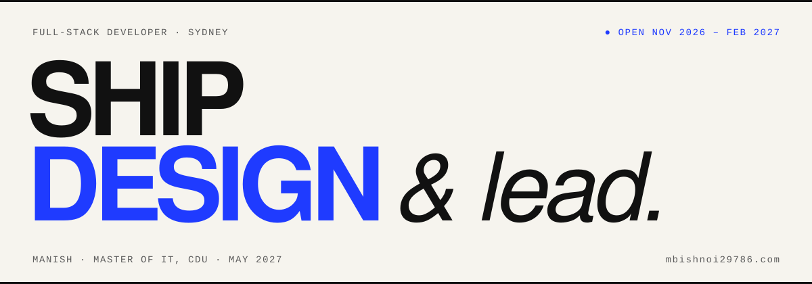

<!-- Profile README · repo must be named exactly: mbishnoi29786/mbishnoi29786 -->
<!-- Upload assets/banner.svg to the same repo so the relative path below resolves. -->

# Hi, I'm Manish.

Full-stack developer in Sydney. Master of IT (Information Systems) at Charles Darwin University, graduating May 2027. Two years shipping real-time apps with Node, React and PostgreSQL. I care about the parts users never see: tenant isolation, access control, CI that fails loudly, endpoints that stay fast.

**Open to a summer internship (Nov 2026 – Feb 2027) and graduate roles from June 2027.**

[**mbishnoi29786.com**](https://mbishnoi29786.com) · [Resume](https://mbishnoi29786.com/assets/docs/Manish_Resume.pdf) · [mbishnoi29786@gmail.com](mailto:mbishnoi29786@gmail.com) · [LinkedIn](https://www.linkedin.com/in/mbishnoi29786)

 

## Live products, built as team lead

<table>
  <tr>
    <td width="50%" valign="top">
      <h3><a href="https://mymise.com.au">MyMise ↗</a></h3>
      
Menu-checking for cafes. Fuzzy-matches counter, QR and Uber Eats menus, runs nine rules, and found all 13 problems in the pilot cafe's menus. Began as a four-person CDU capstone that I led; now a live product.

      
Python · FastAPI · PostgreSQL 16 (row-level security) · Expo / React Native · Azure · GitHub Actions · 100+ tests per push

    </td>
    <td width="50%" valign="top">
      <h3><a href="https://myunilink.com.au">MyUniLink ↗</a></h3>
      
Campus events platform, built with a team I led. Student leaders post, admins approve, students get real-time notifications. Five role levels, audit logs, 20 Prisma models, deployed on AWS EC2 + RDS Sydney.

      
TypeScript · Node.js · Express 5 · React · PostgreSQL · Prisma · Socket.IO · AWS · Vercel

    </td>
  </tr>
</table>

Earlier: [custom-rule-engine](https://github.com/mbishnoi29786/custom-rule-engine) — modular rule evaluator with REST APIs and Jest tests, built in a day for a hackathon · [LetsChat](https://github.com/mbishnoi29786/LetsChat) — encrypted real-time chat with Flask and Socket.IO, for Harvard's CS50.

 

## Stack

| | |
|---|---|
| **Languages** | TypeScript, JavaScript, Python, SQL, C, C++, PHP |
| **Frontend** | React, Vite, React Native (Expo), Tailwind CSS, shadcn/ui, MUI |
| **Backend** | Node.js, Express, FastAPI, Flask, Socket.IO, Prisma, SQLAlchemy, Zod, OpenAPI |
| **Data** | PostgreSQL, MongoDB, Redis, MySQL, SQLite |
| **Cloud** | AWS (EC2, RDS), Azure (Container Apps, Blob Storage), Docker, GitHub Actions, Vercel |
| **Security** | JWT, OAuth 2.0 / OpenID Connect, WebAuthn passkeys, RBAC, PostgreSQL RLS |

 

## Off the keyboard

- **Event Coordinator, SISA** (CDU Sydney IT Students Association) — co-ran IT Code Fair 2026 with the Faculty of Science and Technology; wrote two event proposals, both selected.
- **Secretary, CDU Sydney SaRC** — elected to the first committee of a new social and recreational club.
- **108 volunteer hours** at Vivid Sydney, City2Surf and Ferragosto 2026; Team Leader for 4 of 6 Vivid shifts.
- **Design** — the IT Code Fair 2026 identity (poster, name tags, certificates) and the SaRC logo, in light and dark variants.

 

## Writing

- [Nine rules that found thirteen menu problems](https://mbishnoi29786.com/#blog/mise-nine-rules) — how MyMise matches menus, and why tenant isolation was the first test
- [Eight posters and a pair of brackets](https://mbishnoi29786.com/#blog/it-code-fair-identity) — designing IT Code Fair 2026
- [Writing an event proposal a committee can say yes to](https://mbishnoi29786.com/#blog/funding-proposal)
- [Leading sixteen strangers in the rain at Vivid Sydney](https://mbishnoi29786.com/#blog/vivid-team-lead)

 

<b>GitHub stats</b>

 

<!-- Optional. Delete this block if you'd rather keep the page quiet. Colours match the site: paper #F6F4EE, ink #111111, blue #1F3BFF. -->

  
  

 

© 2026 Manish · Sydney, NSW · Designed and built by hand.
